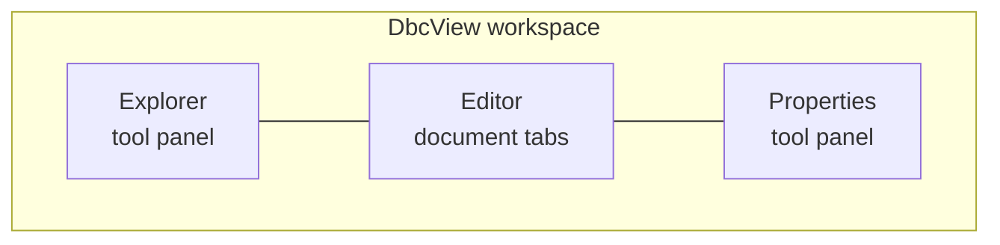
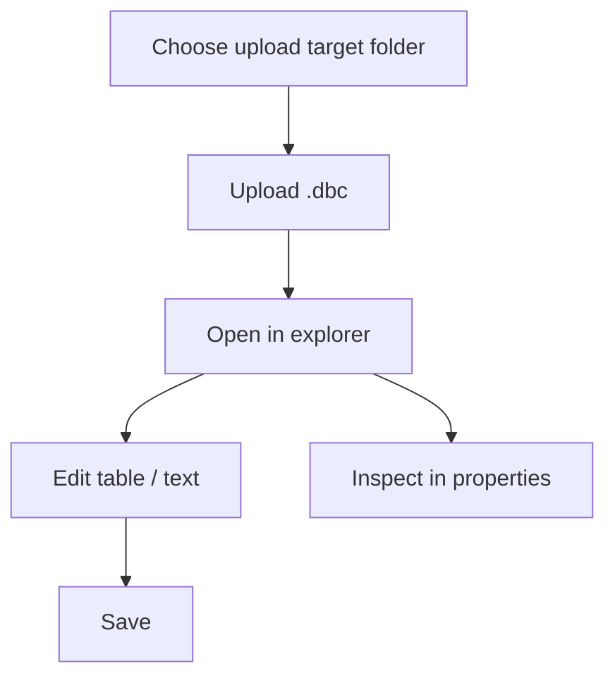

# DbcView

English | [简体中文](README.zh.md)

**A standalone Blazor WebAssembly application for browsing and editing CAN
database (DBC) files.**

## Features

| Capability | Description |
|---|---|
| DBC file explorer | Folder/file tree with local `.dbc` upload |
| Message & signal editor | Table view and raw text view, switchable per document |
| Properties panel | Instant inspection of the selected file, message, or signal |



## Screenshot


## Try it online

A GitHub Pages deployment of the application is available at
<https://HestiaLab.github.io/DbcView/>. Pushes to `main` rebuild and
deploy it through `.github/workflows/deploy.yml`.

## Quick start

Requires the .NET 10 SDK (the repository pins it in `global.json`).

```bash
dotnet restore DbcView.sln --configfile NuGet.Config
dotnet build DbcView.sln --no-restore
dotnet test DbcView.sln --no-build --no-restore
dotnet run --project src/DbcView.Web/DbcView.Web.csproj --no-restore
```

Open the URL printed by `dotnet run`.

## How to use



- Uploads are limited to 4 MB and go to the folder shown as **Upload target**.
- Documents are identified by folder plus file name, so `A/x.dbc` and
  `B/x.dbc` open as separate tabs and save independently.
- Invalid DBC text is kept as an **unvalidated draft**: saving always keeps the
  raw text and shows line-numbered diagnostics with stable codes. A valid
  empty file still reads "No messages in this DBC file".
- Every file and folder entry and the upload picker are keyboard operable;
  below 700 px a compact Explorer / Editor / Properties switcher keeps all
  panels reachable.
- The neutral tool interface follows the operating system light or dark
  color scheme.

## Project structure

```text
DbcView/
├── src/DbcView.Domain/          document model, identity, diagnostics
├── src/DbcView.Application/     use cases and repository/codec ports
├── src/DbcView.Infrastructure/  DBC parser/serializer, in-memory repository
├── src/DbcView.Web/             Blazor WASM presentation + composition root
│   ├── Components/              workspace host + panels
│   ├── Services/                browser upload reader
│   ├── ViewModels/              tree / editor / property models
│   └── Pages/                   Index (/), Verification (/verification)
├── tests/DbcView.Tests/         xUnit + bUnit tests
├── samples/                     sample CAN database files
└── assets/                      README screenshot
```

## Sample data

`samples/bmw_e9x_e8x.dbc` is a community-maintained CAN database for BMW
E9x/E8x vehicles, sourced from
<https://github.com/dzid26/opendbc-BMW-E8x-E9x> (MIT licensed; see the
`CM_ "License MIT"` comment in the file header).

## Disclaimer

The sample file is provided for demonstration and testing only. It is not
endorsed by or affiliated with BMW; "BMW" and vehicle names are trademarks
of their respective owners. The data may be inaccurate or outdated — do not
use it in production vehicles.
