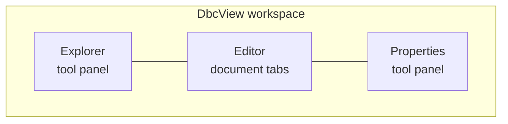
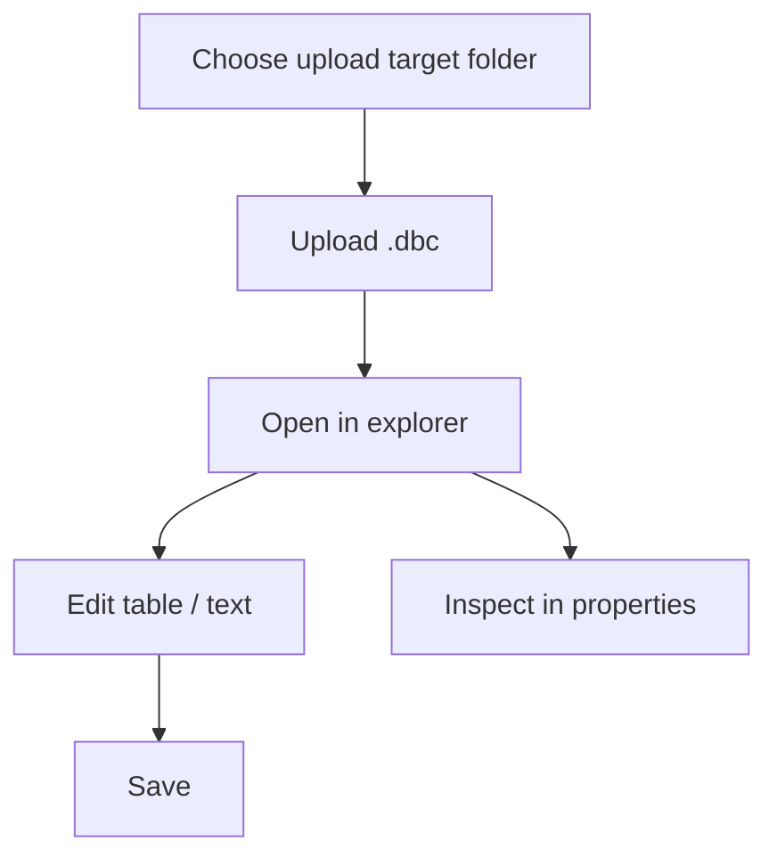

# DbcView

English | [简体中文](README.zh.md)

**A standalone Blazor WebAssembly application for browsing and editing CAN
database (DBC) files.**

## Features

| Capability | Description |
|---|---|
| DBC file explorer | Collapsible folder/file tree with local `.dbc` upload, WAI-ARIA keyboard navigation and theming |
| Message & signal editor | Collapsible, virtualized table with keyboard navigation; switchable raw text view |
| Search | Command palette over message/signal names, decimal/`0x` IDs, transmitters, receivers and comments; `/` or the top-bar search button |
| Properties panel | Read-only General, Comments, Attributes, Value table, Multiplexing, Not displayed and Not interpreted sections with source-line jumps |
| Encoding | BOM/UTF-8 detection with Windows-1252 fallback; undefined bytes are counted and shown |
| Structured edit | Form-based edits for comments, message/signal attributes and signal value tables, with a one-statement preview, Revert all, and a UTF-8 `.reviewed.dbc` download |
| Session persistence | Opt-in local IndexedDB restore of folders, files, current text, open tabs, active tab and Table/Text modes; Forget clears it |



## Screenshot


## Try it online

A GitHub Pages deployment of the application is available at
<https://HestiaLab.github.io/DbcView/>. Pushes to `main` rebuild and
deploy it through `.github/workflows/deploy.yml`.

## Quick start

Requires the .NET 10 SDK (the repository pins it in `global.json`).

```bash
dotnet restore DbcView.sln --configfile NuGet.Config
dotnet build DbcView.sln --no-restore
dotnet test DbcView.sln --no-build --no-restore
dotnet run --project src/DbcView.Web/DbcView.Web.csproj --no-restore
```

Open the URL printed by `dotnet run`.

### Browser tests

The Chromium smoke tests start the Release app on `http://127.0.0.1:5210`:

```bash
dotnet build src/DbcView.Web -c Release
dotnet build tests/DbcView.BrowserTests -c Release
pwsh tests/DbcView.BrowserTests/bin/Release/net10.0/playwright.ps1 install chromium
dotnet test tests/DbcView.BrowserTests -c Release --no-build
```

CI publishes with AOT (`-p:RunAOTCompilation=true`), serves the published output, and
runs the same tests against it via `DBCVIEW_BASE_URL`. AOT is required for the 4 MB
performance envelope; the development-only performance probe is at `/perf`.

## UI components

The workspace dock layout, document tabs and undo history come from
[Atlas.Blazor](https://github.com/HestiaLab/Atlas). The Explorer tree uses
[Astrea.Components](https://github.com/HestiaLab/Astrea) `Tree` 0.8.0 with
stable folder/file ids, controlled selection and expansion, and WAI-ARIA
`tree`/`treeitem` keyboard navigation. Its stylesheet is loaded from the
package and themed through the application's CSS tokens. Both libraries are
consumed as published NuGet packages; no component source is vendored.

## How to use



- Uploads are limited to 4 MB and go to the folder shown as **Upload target**.
- Explorer folders collapse with the chevron; the upload target folder and the
  active file stay highlighted together. The tree is a single tab stop with
  arrow-key navigation.
- Documents are identified by folder plus file name, so `A/x.dbc` and
  `B/x.dbc` open as separate tabs and save independently.
- Invalid DBC text is kept as an **unvalidated draft**: saving always keeps the
  raw text and shows line-numbered diagnostics with stable codes. A valid
  empty file still reads "No messages in this DBC file".
- Messages open collapsed; use the row chevron or `←`/`→` to collapse and
  expand. `↑`/`↓`, `Home`/`End` and `PageUp`/`PageDown` move through rows;
  **Expand all** / **Collapse all** are in the table toolbar.
- Press `/` outside an editable field or use the top-bar search button to open
  the command palette. It searches the active document, ranks exact > prefix >
  substring, and jumps to the exact message or signal row; `Esc` closes it and
  restores focus. Message and signal comments are searchable and highlight in
  Properties.
- Properties shows General, Comments, Attributes, Value table, Multiplexing,
  Not displayed and Not interpreted sections. Source-line buttons switch to
  Text, select the whole statement and focus it; unsaved edits prompt you to
  save first.
- Edit comments, message/signal explicit attributes and signal value tables
  from Properties. A form previews the single changed statement before Apply;
  edits update the in-memory document and Text buffer without writing the
  original file. **Revert all edits** restores the content from when the tab
  was opened. Editing a referenced value table creates an inline copy.
- **Download** reparses the current text first and blocks on errors. It writes
  a new `<original>.reviewed.dbc` file as UTF-8 without a BOM; non-UTF-8
  sources show a conversion notice. The uploaded source is never overwritten.
- Semantic editing is disabled while the Text view has unsaved changes.
- Session persistence is **off by default**. Use the database button in the
  top bar to review the local-only warning and enable it. It stores folders,
  file names, current document text, open tabs, the active tab and Table/Text
  modes in this browser's IndexedDB; unsaved Text drafts are not stored.
  Changes are written after a short debounce and the status bar shows the last
  save time. **Forget saved session** clears the data and disables restoration.
- Invalid saved data or an unsupported schema is discarded with a visible
  message; local storage errors are shown instead of failing silently.
- Uploads are decoded as BOM-marked UTF-8/UTF-16, strict UTF-8, then
  Windows-1252. The status bar and File properties show the detected encoding;
  undefined Windows-1252 bytes are counted and kept as U+FFFD.
- Every file and folder entry and the upload picker are keyboard operable;
  below 700 px a compact Explorer / Editor / Properties switcher keeps all
  panels reachable.
- The neutral tool interface follows the operating system light or dark
  color scheme.

## Project structure

```text
DbcView/
├── src/DbcView.Domain/          document model, identity, diagnostics
├── src/DbcView.Application/     use cases and repository/codec ports
├── src/DbcView.Infrastructure/  DBC parser/serializer, in-memory repository
├── src/DbcView.Web/             Blazor WASM presentation + composition root
│   ├── Components/              workspace host + panels (Atlas, Astrea tree)
│   ├── Services/                browser upload reader
│   ├── ViewModels/              tree / editor / property models
│   └── Pages/                   Index (/), Verification (/verification), Perf (/perf)
├── tests/DbcView.Tests/         xUnit + bUnit tests
├── tests/DbcView.BrowserTests/  Playwright Chromium smoke tests
├── samples/                     sample CAN database files
└── assets/                      README screenshot
```

## Sample data

`samples/bmw_e9x_e8x.dbc` is a community-maintained CAN database for BMW
E9x/E8x vehicles, sourced from
<https://github.com/dzid26/opendbc-BMW-E8x-E9x> (MIT licensed; see the
`CM_ "License MIT"` comment in the file header).

## Disclaimer

The sample file is provided for demonstration and testing only. It is not
endorsed by or affiliated with BMW; "BMW" and vehicle names are trademarks
of their respective owners. The data may be inaccurate or outdated — do not
use it in production vehicles.
