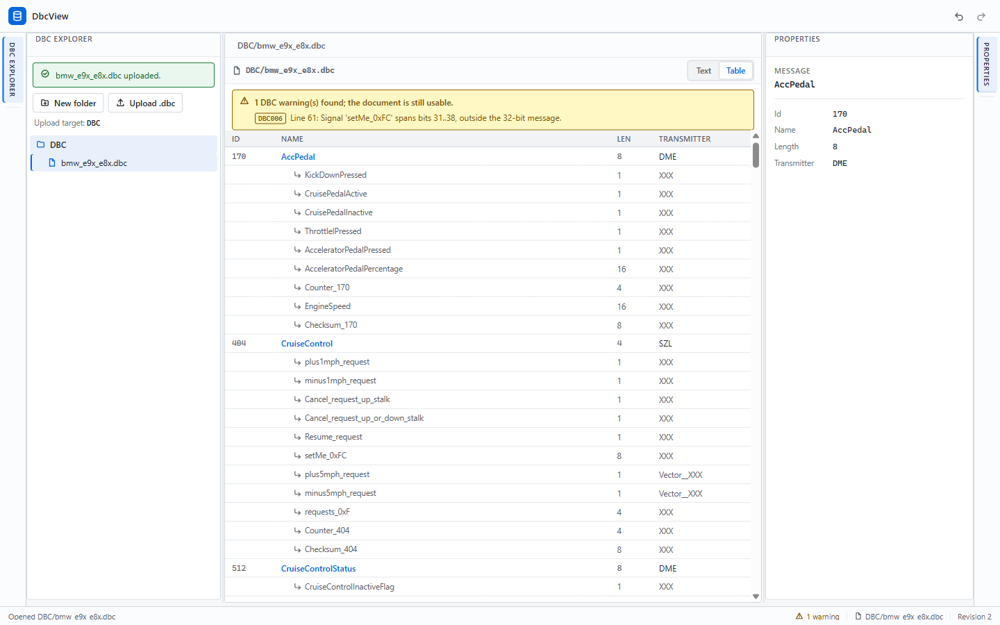
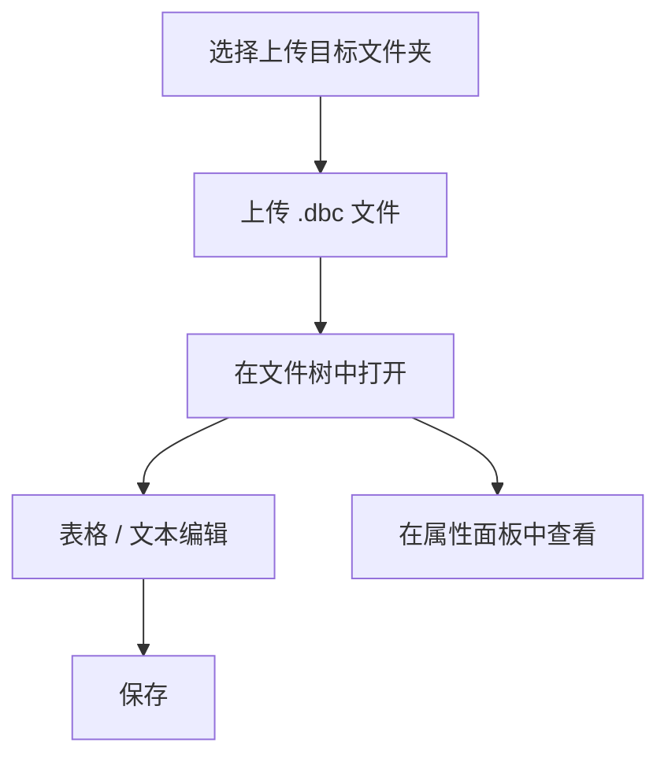

# DbcView

[English](README.md) | 简体中文

**一个用于浏览和编辑 CAN 数据库（DBC）文件的独立 Blazor WebAssembly 应用。**

## 功能特性

| 能力        | 说明                       |
| --------- | ------------------------ |
| DBC 文件浏览器 | 可折叠的文件夹/文件树，支持本地 `.dbc` 上传、WAI-ARIA 键盘导航与主题适配 |
| 消息与信号编辑器  | 可折叠、虚拟化的表格，支持键盘导航；可切换原始文本视图 |
| 搜索            | 命令面板支持消息/信号名、十进制/`0x` ID、发送者、Receiver 与注释；`/` 或顶栏搜索按钮打开 |
| 属性面板      | 只读的 General、Comments、Attributes、Value table、Multiplexing、Not displayed、Not interpreted 分区，并支持源行定位 |
| 编码          | BOM/UTF-8 检测与 Windows-1252 回退；未定义字节计数并展示 |
| 结构化编辑    | 通过表单编辑注释、消息/信号属性与信号值表；单语句差异预览、Revert all、UTF-8 `.reviewed.dbc` 下载 |
| 会话持久化    | 可选启用本地 IndexedDB 恢复文件夹、文件、当前文本、打开标签、活动标签与 Table/Text 模式；Forget 清除 |


## 界面截图



## 在线试用

<https://HestiaLab.github.io/DbcView/> — 无需安装，直接访问即可使用。

## 快速开始

需要 .NET 10 SDK（仓库通过 `global.json` 固定版本）。

```bash
dotnet restore DbcView.sln --configfile NuGet.Config
dotnet build DbcView.sln --no-restore
dotnet test DbcView.sln --no-build --no-restore
dotnet run --project src/DbcView.Web/DbcView.Web.csproj --no-restore
```

打开 `dotnet run` 输出的 URL。

### 浏览器测试

Chromium 冒烟测试会在 `http://127.0.0.1:5210` 启动 Release 应用：

```bash
dotnet build src/DbcView.Web -c Release
dotnet build tests/DbcView.BrowserTests -c Release
pwsh tests/DbcView.BrowserTests/bin/Release/net10.0/playwright.ps1 install chromium
dotnet test tests/DbcView.BrowserTests -c Release --no-build
```

CI 使用 AOT 发布（`-p:RunAOTCompilation=true`），通过 `DBCVIEW_BASE_URL` 对发布产物运行同一套测试。
4 MB 性能包络依赖 AOT；仅开发使用的性能探针位于 `/perf`。

## UI 组件

工作区停靠布局、文档标签与撤销历史来自
[Atlas.Blazor](https://github.com/HestiaLab/Atlas)。Explorer 文件树使用
[Astrea.Components](https://github.com/HestiaLab/Astrea) 的 `Tree` 0.8.0：
稳定的文件夹/文件 id、受控选中与展开、WAI-ARIA `tree`/`treeitem` 键盘导航。
树样式表由包提供，并通过应用的 CSS 令牌适配明暗主题。两者均以已发布
NuGet 包形式消费，不引入组件源码。

## 使用方法



- 上传上限为 4 MB，文件会进入界面上显示的 **Upload target** 文件夹。
- 文件树中的文件夹可用箭头折叠/展开；上传目标文件夹与活动文件会同时高亮。
  树是单一 Tab 停靠点，支持方向键导航。
- 文档标识由目录与文件名共同组成，因此 `A/x.dbc` 与 `B/x.dbc` 会作为
  两个独立标签打开并分别保存。
- 非法 DBC 文本会保留为**未验证草稿**：保存始终保留原始文本，并显示带行号
  和稳定错误码的诊断信息。合法空文件仍显示 “No messages in this DBC file”。
- 消息默认折叠；使用行内箭头或 `←`/`→` 折叠/展开。`↑`/`↓`、`Home`/`End`
  与 `PageUp`/`PageDown` 在行间移动；表格工具栏提供 **Expand all** /
  **Collapse all**。
- 焦点不在可编辑控件时按 `/`，或点击顶栏搜索按钮，可打开命令面板。它只搜索
  当前文档，按精确 > 前缀 > 子串排序，并精确跳转到消息或信号行；`Esc`
  关闭并把焦点归还。消息/信号注释也可搜索，并在 Properties 中高亮。
- Properties 展示 General、Comments、Attributes、Value table、Multiplexing、
  Not displayed、Not interpreted 分区。源行按钮会切到 Text、选中整条语句并聚焦；
  存在未保存文本时先提示保存。
- 可在 Properties 中编辑文件/消息/信号注释、消息/信号显式属性与信号值表。表单会
  预览唯一被修改的语句；Apply 更新内存文档与 Text 缓冲区，不写原文件。
  **Revert all edits** 恢复到标签打开时的内容。编辑 `VAL_TABLE_` 引用会创建内联副本。
- **Download** 会先重新解析当前文本，存在 error 时阻止下载。输出为新的
  `<原名>.reviewed.dbc`，固定 UTF-8 无 BOM；非 UTF-8 源文件会提示编码转换。
  上传的源文件不会被覆盖。
- Text 视图存在未保存修改时，语义编辑按钮禁用。
- 会话持久化**默认关闭**。点击顶栏数据库按钮，阅读仅本地存储的说明后启用。
  它会在当前浏览器的 IndexedDB 中保存文件夹、文件名、当前文档文本、打开标签、
  活动标签与 Table/Text 模式；Text 未保存草稿不会存入。修改经过短暂防抖后写入，
  状态栏显示最后保存时间。**Forget saved session** 会清除数据并关闭恢复。
- 数据损坏或 schema 不兼容时整体丢弃并显示提示；本地存储失败会明确显示，
  不静默丢数据。
- 上传按 BOM 标记的 UTF-8/UTF-16、严格 UTF-8、Windows-1252 顺序解码。状态栏与
  File Properties 显示检测到的编码；Windows-1252 未定义字节会计数并保留为 U+FFFD。
- 文件、文件夹和上传选择器均可仅用键盘操作；宽度低于 700 px 时，通过
  Explorer / Editor / Properties 切换器保证所有面板可达。
- 中性的工具型界面会跟随操作系统的浅色或深色配色。

## 项目结构

```text
DbcView/
├── src/DbcView.Domain/          文档模型、标识与诊断
├── src/DbcView.Application/     用例、仓储与编解码端口
├── src/DbcView.Infrastructure/  DBC 解析/序列化、内存仓储
├── src/DbcView.Web/             Blazor WASM 表现层与组合根
│   ├── Components/              工作区宿主与面板（Atlas、Astrea 树）
│   ├── Services/                浏览器上传读取
│   ├── ViewModels/              文件树/编辑器/属性视图模型
│   └── Pages/                   Index (/)、Verification (/verification)、Perf (/perf)
├── tests/DbcView.Tests/         xUnit + bUnit 测试
├── tests/DbcView.BrowserTests/  Playwright Chromium 冒烟测试
├── samples/                     样例 CAN 数据库文件
└── assets/                      README 截图
```

## 样例数据

`samples/bmw_e9x_e8x.dbc` 是社区维护的 BMW E9x/E8x 车型 CAN 数据库文件，来源为
<https://github.com/dzid26/opendbc-BMW-E8x-E9x>（MIT 许可；见文件头
`CM_ "License MIT"` 注释）。

## 免责声明

样例文件仅用于演示和测试。与 BMW 无任何关联或认可关系；"BMW" 及车辆名称均为
各自所有者的商标。数据可能不准确或已过时，请勿用于生产车辆。

## 许可证

本项目采用 [Apache License 2.0](LICENSE) 许可。

Copyright 2026 HestiaLab.

第三方样例数据保留原始许可：`samples/bmw_e9x_e8x.dbc` 为 MIT 许可，详见文件头。
