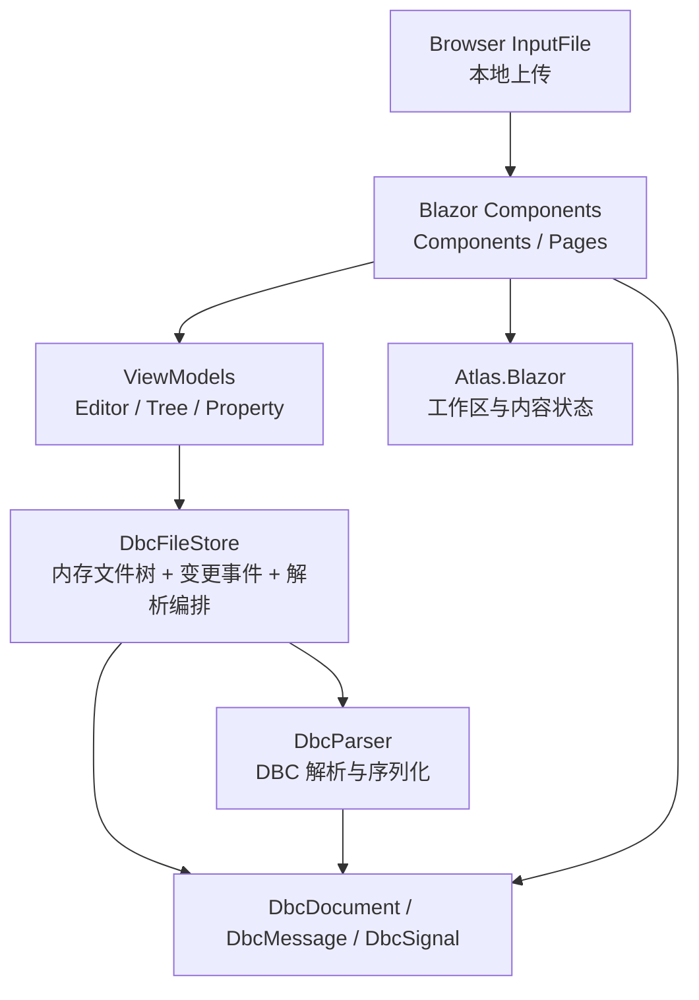
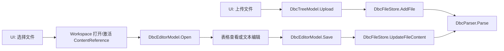
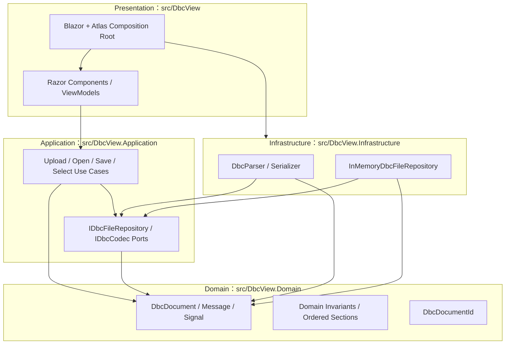

# DbcView 架构与代码质量审计报告

- 审计日期：2026-10-28
- 审计基线：`main` / `4bf6d9c91ef197d9a15538216321be947dd574c7`
- 审计目标：指导整改，而非仅作现状汇报
- 交付范围：产品代码、测试、构建与 CI/CD、依赖、文档、样本及关键浏览器流程
- 排除范围：第三方包和 `bin/obj` 的内部源码不审计；其版本、引用方式与仓库管理仍在范围内
- 变更约束：审计过程中未修改产品代码；本报告是唯一计划新增的仓库文件

## 1. 执行摘要

当前项目能够还原、构建并通过全部现有测试，真实 BMW 样本也能在浏览器中完成上传、打开、消息/信号属性查看和文本保存。现有领域模型不依赖 UI，中央包版本、nullable、确定性构建、跨平台 CI、工作区状态隔离测试都是良好基础。

但“构建和测试通过”尚不能代表关键输入边界与发布路径可靠。本次审计确认：

| 级别 | 数量 | 主要结论 |
|---|---:|---|
| P0 | 0 | 未发现已证实的大规模数据破坏、远程利用或完全不可用问题 |
| P1 | 4 | 无效 DBC 被误报为空文档、上传 I/O 异常未处理、部署缺少 CI 成功门禁、.NET 6 已停止支持 |
| P2 | 12 | 往返序列化重排、文档标识不完整、应用层缺失、可访问性/窄屏问题、测试与依赖工程缺口 |
| P3 | 12 | 测试脆弱性、死代码、误导性演示控件、覆盖率未入 CI、工作流最小权限与供应链固定等低优先级问题 |

最应先处理的不是大规模分层重构，而是 Q-01 至 Q-04。架构整改应在关键负面路径有回归保护后进行；.NET/依赖升级与四层迁移分轨实施，避免一次性扩大变更面。

## 2. 审计方法与判定口径

### 2.1 方法

采用 `architecture-visualization:system-modeler` 建立当前代码证据模型，使用 `architecture-visualization:risk-quality-reviewer` 评估风险与质量属性，并按 `code-quality-analysis` 完成自动化统计、热点阅读、依赖与测试检查。架构小图使用 Markdown 原生 Mermaid，当前态与目标态分别标注。

实际执行了：

- 全量产品源码阅读，以及测试、工作流、项目配置和贡献文档审查。
- 非生成源码行数、测试数量、重复代码块和危险模式扫描。
- 还原、构建、测试、格式验证、Cobertura 覆盖率与 NuGet 漏洞检查。
- 独立控制台复现解析/序列化问题。
- Playwright 浏览器验证上传、文件打开、消息/信号属性、文本编辑保存、双工作区、无效输入、超限输入和窄屏布局。
- 报告初稿完成后，进行问题真实性、安全遗漏和统计一致性三路独立复核。

### 2.2 证据等级

| 标记 | 含义 |
|---|---|
| 运行复现 | 已通过浏览器、控制台或实际命令观察到问题 |
| 静态确认 | 代码或配置直接证明缺陷存在，但特定故障后果尚未动态注入 |
| 待验证风险 | 存在风险条件，但缺少需求、性能或环境证据，不作为已确认缺陷夸大结论 |

### 2.3 严重度与工作量

- P0：已证实的灾难性数据损失、严重安全暴露或核心系统不可用，需立即停止发布。
- P1：重要正确性、发布完整性或安全维护风险，当前迭代优先处理。
- P2：结构性缺陷、明显体验问题或中等工程风险，下一整改阶段处理。
- P3：局部可维护性、测试可靠性和工程卫生问题，持续改进。
- S：局部小改；M：跨多个文件或需要行为设计；L：跨项目、调用链或迁移级改动。

## 3. 当前架构与核心流程

### 3.1 当前模块关系（当前态）

当前只有一个产品程序集。`ViewModels` 直接依赖具体 `DbcFileStore`；`DbcFileStore` 同时负责文件树、写入、解析触发和变更通知；Blazor 组件负责上传、工作区操作、文档打开和属性选择编排。严格四层所要求的应用用例和端口尚未形成。

### 3.2 关键调用链（当前态）

### 3.3 值得保留的设计

- `Models/Dbc/DbcDocument.cs` 不依赖 Blazor、Atlas 或浏览器 API，具备提取为领域层的条件。
- 编辑器按 `ContentReference` 获取独立状态，已有跨文档未保存文本回归测试，避免了一个全局编辑器单例。
- `DbcFileStore` 以不可变记录替换文件快照，面板间共享同一内存源，职责虽然需要拆分，但状态传播路径清晰。
- CI 覆盖 Ubuntu/Windows，且启用 nullable、确定性构建、分析器、中央包版本和格式验证。
- 真实样本往返测试、重复上传测试、双工作区隔离测试及 ARIA 关系测试具有实际价值。

## 4. P1：当前迭代优先处理

### Q-01 无效 DBC 缺少结构校验与诊断，且解析异常被完全吞掉

- 级别/证据：P1；运行复现，并有静态证据。
- 位置：`src/DbcView/Services/DbcParser.cs:24-47`、`src/DbcView/Services/DbcFileStore.cs:116-127`、`src/DbcView/Components/DbcEditorPanel.razor:41-47`、`src/DbcView/ViewModels/DbcEditorModel.cs:68-85`。
- 问题：`Parse` 没有要求最基本的 `VERSION`/`BU_:` 结构，任意文本可返回一个零消息文档；结构化坏文件抛出的异常又被无类型 `catch` 吞掉，调用方只能得到 `Parsed = null`，没有错误类型、位置或消息。保存同样没有验证结果或错误反馈。
- 运行证据：上传包含 `this is not a DBC file` 的文件后，界面显示“**No messages in this DBC file**”，而非格式错误。独立复现得到 `ARBITRARY_TEXT_PARSE_NULL=False`、`ARBITRARY_TEXT_MESSAGES=0`；含 `BU_:` 和坏 `BO_` 的输入则得到 `MALFORMED_MESSAGE_PARSE_NULL=True`。
- 影响：用户无法区分“合法空 DBC”与“根本不是 DBC”，也无法修复具体格式错误；无效内容可被继续保存，破坏编辑工具最基本的数据可信性。
- 整改方向：定义明确的解析契约和结构化诊断结果；区分合法空文档、语法错误和不支持的语法。保留原始草稿与错误展示，但不要用无类型捕获掩盖编程异常。保存策略需明确：拒绝无效写入，或显式以“未验证原始文本”语义保存并警告。
- 范围/工作量：解析器、文件写入应用服务、编辑器模型与错误 UI、负面测试；M。
- 验收：任意文本、坏消息头、非法数字、越界位定义均产生可读诊断和稳定状态；合法空文件仍显示“无消息”；错误不会导致未处理异常或静默覆盖，真实样本回归通过。

### Q-02 上传读取发生在异常保护之外，超限文件产生未处理异常

- 级别/证据：P1；运行复现。
- 位置：`src/DbcView/Components/DbcTreePanel.razor:70-97`，尤其是 `:80-83` 与 `:88-94`。
- 问题：`OpenReadStream` 和 `ReadToEndAsync` 位于 `try` 外，当前只捕获重复文件导致的 `InvalidOperationException`。
- 运行证据：上传 4,194,338 字节文件（限制 4,194,304 字节）后，浏览器控制台出现 `System.IO.IOException`，堆栈定位到 `DbcTreePanel.razor:80`；界面无上传错误消息，`#blazor-error-ui` 仍为 `display: none`。
- 影响：文件过大、读取失败或浏览器 I/O 错误会逃逸事件处理器；用户看不到失败原因，也难以判断应用是否仍可继续操作。
- 边界补充：`e.GetMultipleFiles()`（`:78`）也在保护范围外，若有路径启用多选，数量超限会在读取前抛出异常。当前 `InputFile` 未启用多选，因此这是潜在路径，不计入当前运行复现。
- 整改方向：把完整文件集合读取/解析/写入边界纳入有针对性的异常处理，向用户保留每个失败文件的诊断，并确保失败后状态一致。
- 范围/工作量：上传组件、应用层上传用例与浏览器负面测试；S。
- 验收：超限和读取失败均显示明确提示、无未处理控制台异常、已有文件不变、后续上传仍可成功；重复文件行为不回归。

### Q-03 Pages 部署不依赖 CI 成功

- 级别/证据：P1；静态确认。
- 位置：`.github/workflows/deploy.yml:3-6`、`:29-30`，`.github/workflows/ci.yml:32-36`。
- 问题：`main` 推送会直接触发 publish；构建/测试位于独立工作流，两者没有 `needs` 或成功完成条件。
- 影响：CI 的测试、格式检查或仅测试项目的编译失败不会阻止本工作流发布；产品项目自身编译失败会由部署工作流的 `Publish` 步骤阻断。仓库外环境保护规则未核验，但工作流自身没有完整质量门禁。
- 整改方向：将验证与发布放入同一工作流并用 `needs` 串联，或以受控的 CI 成功事件触发部署；手动触发也必须执行同一组验证。
- 范围/工作量：CI/CD 工作流与一次失败/成功路径演练；S。
- 验收：人为失败的测试能阻止 artifact 和 deploy；全部验证成功才可发布；并发与 Pages 最小权限设置保留。

### Q-04 产品与测试均固定到已停止支持的 .NET 6

- 级别/证据：P1；构建确认。
- 位置：`src/DbcView/DbcView.csproj:3`、`tests/DbcView.Tests/DbcView.Tests.csproj:3`、`Directory.Packages.props:8-10`、`.github/workflows/ci.yml:24-27`、`.github/workflows/deploy.yml:24-27`。
- 问题：目标框架、ASP.NET Core 包和 CI SDK 均为 6.0。.NET 6 已于 2024-11-12 结束支持。
- 运行证据：当前 SDK 构建产生 `NETSDK1138`：“目标框架 net6.0 不受支持，将来不会收到安全更新”；结果为 0 错误、1 警告。
- 影响：运行时和框架不再获得新的安全修复，也使依赖升级和工具链一致性持续恶化。
- 整改方向：单独建立升级轨道，优先评估当前受支持 LTS（本报告日期为 .NET 10），同步 ASP.NET Core 包、CI、文档和 SDK 固定策略；先验证 `Atlas.Blazor 0.2.0` 兼容性，不与四层重构捆绑。
- 范围/工作量：项目文件、中央包版本、CI/CD、文档、全量回归；M，若 Atlas 不兼容则重新评估。
- 验收：目标框架处于支持期，构建无 EOL 警告，测试、格式、浏览器冒烟和发布全部通过；依赖漏洞扫描无新增问题。

## 5. P2：结构与重要质量问题

### Q-05 序列化会把消息间的注释/属性段落移动到文件末尾

- 级别/证据：P2；独立控制台复现。
- 位置：`src/DbcView/Services/DbcParser.cs:49-62`、`:87-108`；数据模型限制见 `src/DbcView/Models/Dbc/DbcDocument.cs:27-34`。
- 问题：所有不属于消息头/信号的行都汇总进单个 `TrailingSections`，序列化时统一在全部消息之后写回，模型无法表达这些段落原来的相对位置。
- 运行证据：位于第一条和第二条 `BO_` 之间的 `CM_ "comment between messages";` 在输出中移动到第二条消息之后，`COMMENT_MOVED=True`。
- 影响：非空白内容顺序被破坏，可能改变注释、属性或值描述与其上下文的可读关联。当前 UI 保存只写原始文本，`Serialize` 仅在测试中使用，因此这是公共解析/序列化能力与未来导出路径的风险，不声称当前 UI 已因此丢失数据。
- 整改方向：用有序文档段落/节点表示消息与附属段，或明确只支持受限结构并删除过强的“round-trip preservation”承诺。
- 范围/工作量：文档模型、解析器、序列化器和顺序测试；M。
- 验收：消息间 `CM_`、`BA_`、`VAL_` 等代表用例保持非空白内容顺序；现有真实样本和规范化规则继续通过。

### Q-06 文档标签与状态标识只使用文件名，未包含目录

- 级别/证据：P2；静态确认，当前 UI 触发条件受限。
- 位置：`src/DbcView/Components/DbcViewWorkspace.razor:122-131`、`src/DbcView/Components/DbcEditorPanel.razor:139`、`:155-169`；存储唯一键范围见 `src/DbcView/Services/DbcFileStore.cs:48-53`。
- 问题：存储允许“不同目录下的同名文件”，但编辑器 `ContentReference.ResourceId` 只有 `file.Name`，状态解析也只比较文件名。
- 影响：一旦其他调用方或未来 UI 支持跨目录同名文件，两个文档会命中同一去重键和状态作用域，可能激活错误标签或把保存定向到原模型目录。当前上传固定首目录，因此本报告把它列为潜在模型缺陷，而非当前 UI 已复现的数据丢失。
- 整改方向：引入包含目录与文件名的稳定 `DbcDocumentId`，用于存储、标签、内容状态和标题同步。
- 范围/工作量：标识值对象、工作区、编辑器状态和跨目录测试；M。
- 验收：`A/x.dbc` 与 `B/x.dbc` 能同时打开、独立编辑并分别保存，标签去重与恢复均使用完整标识。

### Q-07 缺少应用层与端口，严格四层依赖无法由工程边界保证

- 级别/证据：P2；静态确认（按选定的四层目标评价）。
- 位置：`src/DbcView/ViewModels/DbcEditorModel.cs:20-25`、`:68-83`，`src/DbcView/ViewModels/DbcTreeModel.cs:13-20`、`:43-45`，`src/DbcView/Services/DbcFileStore.cs:48-57`、`:116-129`，`src/DbcView/Components/DbcViewWorkspace.razor:62-89`。
- 问题：表现层直接调用具体存储；存储同时承担解析编排；上传/打开/保存没有用例边界；单程序集不能阻止跨层依赖。现有包边界测试还禁止所有项目引用，见 Q-13。
- 影响：解析、状态存储和 UI 的变化容易相互扩散，难以独立测试用例，也无法以编译依赖证明“领域不依赖外层”。
- 整改方向：按第 8 节提取 Domain、Application、Infrastructure、Presentation；先引入端口和用例，再移动实现，不做一次性重写。
- 范围/工作量：项目边界、依赖注入、上传/打开/保存调用链、边界测试；L。
- 验收：依赖规则由项目引用和自动测试双重约束；领域层无 Blazor/Atlas/浏览器依赖，表现层不直接构造具体基础设施，核心用例可脱离 UI 测试。

### Q-08 上传目标硬编码为首个目录，新建目录无法成为上传目标

- 级别/证据：P2；静态确认。
- 位置：`src/DbcView/Components/DbcTreePanel.razor:65-75`。
- 问题：每次上传选择 `Model.Folders[0]`，目录没有选中/指定语义；“New folder”只创建自动命名目录。
- 影响：多目录功能基本不可用于组织上传文件，也掩盖了 Q-06 的同名文件场景。
- 整改方向：明确当前目录选择状态，上传前解析目标目录；若产品只需单目录，应删除无效的多目录入口而不是保留假能力。
- 范围/工作量：树模型、上传用例、目录 UI 和测试；S。
- 验收：用户能把文件上传到指定目录；重名只针对目标目录判断；默认目录创建行为保持明确。

### Q-09 工作区与标题更新存在未观察异步错误和未检查操作结果

- 级别/证据：P2；静态确认，故障后果尚未注入复现。
- 位置：`src/DbcView/Components/DbcViewWorkspace.razor:91-134`、`:170-174`，`src/DbcView/Components/DbcEditorPanel.razor:176-196`。
- 问题：文件选择在 `async void` 中执行工作区操作，打开/关闭结果未检查；编辑器使用 fire-and-forget `InvokeAsync`，其中还执行 `UpdatePresentationAsync`，异常没有观察或反馈路径。
- 影响：工作区拒绝操作、标签打开失败或标题同步失败时，界面可能静默保持错误状态，部分异常可能进入未处理路径。
- 整改方向：统一异步命令结果与异常处理；能用 `EventCallback`/受控任务替代时避免 `async void`，后台任务至少集中记录并更新可见状态。
- 范围/工作量：工作区命令、编辑器标题同步、故障注入测试；M。
- 验收：模拟关闭、打开和标题更新失败时，状态栏/错误区显示诊断，无未观察任务异常，当前文档与缓冲区不损坏。

### Q-10 窄屏下编辑器宽度变为 0，属性面板被裁出视口

- 级别/证据：P2；运行复现。
- 位置：`src/DbcView/Components/DbcViewWorkspaceDefinition.cs:54-81`、`src/DbcView/wwwroot/css/app.css:53-64`、`:355-383`。
- 问题：固定像素/最小约束与整体 `overflow: hidden` 组合，没有为核心文档区定义窄屏重排或可访问的折叠策略。
- 运行证据：375×667 的 `/verification` 页面中，两个工作区的 `.dbc-editor` 宽度均为 `0`；属性面板从 `x=341.20` 开始且宽 `276.20`，超出 375 px 视口。页面级 `scrollWidth` 仍为 375，因此被隐藏而非可滚动访问。
- 影响：手机或窄窗口中核心编辑能力不可用，现有媒体查询只隐藏工具栏文字，没有解决工作区布局。
- 整改方向：为窄屏定义单区域/标签化布局或可操作的区域切换，不以隐藏溢出代替响应式设计。
- 范围/工作量：工作区定义、CSS、320/375/620 px 浏览器测试；M。
- 验收：目标宽度下编辑、上传和属性入口均可达，核心区域宽度非零，无不可达裁切；桌面布局不回归。

### Q-11 文件打开和上传无法仅通过键盘完成

- 级别/证据：P2；运行确认与静态证据。
- 位置：`src/DbcView/Components/DbcTreePanel.razor:14-17`、`:32-37`，`src/DbcView/wwwroot/css/app.css:415-420`。
- 问题：文件项是无角色、无键盘处理的可点击 `div`；上传 `input` 被 `display:none`，包裹 `label` 也不可聚焦。
- 运行证据：文件项 `tabIndex=-1`、`role=null`；上传输入 `display:none`、标签 `tabIndex=-1`。
- 影响：键盘用户无法浏览/打开文件或触发上传，屏幕阅读器也不能获得正确的可操作语义。
- 整改方向：优先使用原生 `button`/链接和可见聚焦样式；文件选择控件采用可聚焦的视觉隐藏方案，而非 `display:none`。
- 范围/工作量：树组件、CSS、键盘与可访问性测试；S。
- 验收：仅用 Tab、Shift+Tab、Enter/Space 可完成上传和文件打开，焦点可见，角色/名称/选中状态正确。

### Q-12 浅色主题多处文字对比度低于 WCAG AA

- 级别/证据：P2；按实际色值静态计算。
- 位置：`src/DbcView/wwwroot/css/app.css:15-27`、`:412-444`。
- 问题：浅色主题的选中文件白字/`#6bcb77` 为 2.01:1，表头白字/`#4d96ff` 为 2.95:1，顶栏白字/`#e63946` 为 4.17:1，编辑器链接 `#e63946`/`#fffdf7` 为 4.10:1。
- 影响：小字号正文未达到 4.5:1，低视力用户难以辨认；选中态和表头尤其明显。
- 整改方向：调整前景/背景令牌，而不是逐选择器补丁；同时验证悬停、选中、禁用和深色主题。
- 范围/工作量：主题令牌与对比度回归；S。
- 验收：正常文字至少 4.5:1、大号文字至少 3:1，相关非文本指示至少 3:1；所有交互状态保留清晰焦点。

### Q-13 测试使用二进制 HintPath；边界测试对所有 ProjectReference 一刀切

- 级别/证据：P2；配置静态确认。
- 位置：`tests/DbcView.Tests/DbcView.Tests.csproj:17-20`、`DbcView.sln:8-11`、`tests/DbcView.Tests/DemoPackageBoundaryTests.cs:23-37`、`CONTRIBUTING.md:9-16`。
- 问题：测试直接引用 `bin/$(Configuration)` 下的 DLL，独立构建依赖既有输出和解决方案级顺序；同时边界测试禁止任意项目引用，使合理的内部引用也无法使用，并与四层项目拆分目标冲突。
- 影响：干净环境直接构建测试项目可能缺少 DLL，已有输出时存在陈旧程序集风险；架构迁移会被过宽规则阻塞。当前“先构建整个解决方案”的 README/CI 路径可正常工作，不能误判为现有 CI 必坏。
- 整改方向：允许明确的 DbcView 内部 `ProjectReference`，把边界规则收窄为“禁止 Atlas 源码项目/链接文件及非法依赖方向”。
- 范围/工作量：测试项目、边界测试、贡献文档和解决方案；S。
- 验收：干净检出后单独构建/测试测试项目成功；解决方案不依赖旧 DLL；Atlas 消费边界仍由测试保证，目标四层引用可合法表达。

### Q-14 测试依赖链存在 AngleSharp 1.2.0 中等严重度公告

- 级别/证据：P2；实际 NuGet 漏洞扫描确认。
- 位置：中央版本 `Directory.Packages.props:7`；传递依赖来自当前测试包图。
- 问题：`dotnet list DbcView.sln package --vulnerable --include-transitive` 报告测试项目 `AngleSharp 1.2.0`，Moderate，公告 `GHSA-pgww-w46g-26qg`。产品项目未报告漏洞。
- 影响：风险位于测试工具链而非已发布产品运行时，但测试输入解析与开发/CI 环境仍应避免已知漏洞版本。
- 整改方向：公告影响 AngleSharp `<1.5.0`，修复版本为 `1.5.0`；升级到包含修复且与 bUnit 兼容的依赖组合，并重新检查完整传递包图。
- 范围/工作量：中央包版本与测试回归；S。
- 验收：漏洞命令对产品与测试、直接与传递依赖均不再报告该公告；35 项现有测试及新增负面测试通过。

### Q-15 高行覆盖率未覆盖本次复现的关键负面路径

- 级别/证据：P2；测试审查与实际覆盖率对照确认。
- 位置：`tests/DbcView.Tests/DbcParserTests.cs:108-119`、`tests/DbcView.Tests/DbcPanelsTests.cs:38-80`、`:103-121`、`tests/DbcView.Tests/DbcViewWorkspaceTests.cs:90-169`。
- 问题：所谓 edge cases 仍是合法空文档/无信号消息；上传负面测试只覆盖重名；保存只覆盖合法 DBC；多文档测试使用不同文件名。Q-01、Q-02、Q-05、Q-06、Q-10、Q-11 均无对应回归。
- 影响：35 项测试全绿、88.54% 行覆盖仍无法防止本次最重要问题回归，覆盖率容易形成错误安全感。
- 整改方向：先为 P1/P2 建立行为测试，再讨论阈值；浏览器负面路径与 bUnit/纯用例测试分层承担。
- 范围/工作量：解析、上传、标识、响应式和键盘测试；M。
- 验收：每个 P1 问题至少有一个能失败的回归测试；Q-05/Q-06 有针对性用例；窄屏与键盘路径由实际浏览器断言覆盖。

### Q-16 工作区交互测试使用 Loose JSInterop，且“交互来源”只检查属性

- 级别/证据：P2；静态确认（覆盖缺口，不宣称拖拽已存在缺陷）。
- 位置：`tests/DbcView.Tests/DbcPanelsTests.cs:17-21`、`tests/DbcView.Tests/DbcViewWorkspaceTests.cs:26-30`、`:246-264`。
- 问题：JS 调用被宽松处理；最后述测试只验证 drag 属性、separator 和 ARIA，没有执行 pointer/键盘交互或验证位置状态。
- 影响：缺失/错误 JS 调用、拖拽、分隔条与键盘行为回归可能全部通过。
- 整改方向：交互套件使用 Strict JSInterop 和显式 Setup/Verify；增加实际 pointer、键盘、焦点与尺寸断言，纯结构 smoke test 可继续使用 Loose。
- 范围/工作量：bUnit 交互套件与少量浏览器端测试；M。
- 验收：缺失预期 JS 调用会使测试失败；至少一条拖拽和一条键盘分隔条路径验证实际状态变化。

## 6. P3：低优先级与工程卫生

| ID | 证据与影响 | 修复方向与验收 | 工作量 |
|---|---|---|---|
| Q-17 | 多个顶栏按钮没有行为，分支/换行/编码状态硬编码：`DbcViewTopToolbar.razor:3-20`、`DbcViewStatusBar.razor:5-8`。演示外观可能被理解为真实能力。 | 实现、禁用并标注演示，或移除；状态只能来自真实文档/工作区。验收是不存在可点击但无响应的假入口，状态随内容变化。 | S |
| Q-18 | `_message`/`_signal` 仅写不读：`DbcPropertyModel.cs:13-14`、`:49-93`；`HandleSignalSelected` 的 `message` 参数未使用：`DbcEditorPanel.razor:204-207`。增加状态理解成本。 | 删除死字段与无效参数。验收为行为测试不变、编译通过且无新的未使用成员。 | S |
| Q-19 | 一组旧 demo 样式在当前 Razor/HTML 中无对应元素：`app.css:288-353`（tree/service/code/markdown/terminal 等），`:381` 仍有相关响应式规则。 | 删除无引用样式或恢复其真实使用方；用选择器清单复查。验收为现有桌面/窄屏截图无回归，样式表不再包含该批死规则。 | S |
| Q-20 | 已引用 coverlet：`DbcView.Tests.csproj:14`，但 CI 测试没有 coverage 参数或产物：`.github/workflows/ci.yml:35-36`。本次手工覆盖率为 88.54%/75%，CI 无法发现退化。 | 至少在一个 OS 收集并上传 Cobertura；先有稳定基线再讨论门槛。验收为 CI 产物可下载、指标与本地一致、失败时不上传误导性空报告。 | S |
| Q-21 | 包边界测试递归加载整个工作树的 `*.csproj`，未应用生成目录过滤：`DemoPackageBoundaryTests.cs:25-27` 对比 `:81-88`。无关临时项目可造成非确定性失败。 | 只扫描受控项目或统一过滤 `bin/obj/.packages` 等。验收为在无关临时项目存在时测试仍只验证仓库受控输入。 | S |
| Q-22 | 测试按按钮索引操作：`DbcPanelsTests.cs:95-99`、`:114-120`；样本读取依赖进程当前目录：`DbcParserTests.cs:76`。重排按钮或 runner 工作目录变化会造成脆弱失败。 | 使用角色/可访问名称或稳定 testid；样本以 `AppContext.BaseDirectory` 定位。验收为按钮重排不影响语义选择，从不同工作目录运行测试均通过。 | S |
| Q-23 | fork PR 也进入看板 action 并无条件使用 PAT：`.github/workflows/add-to-project.yml:9-12`、`:20-23`；fork 通常拿不到仓库 secrets，外部贡献自动化会失败。 | 明确跳过无凭据的 fork PR 并人工补录，或采用最小权限的独立元数据流程；不得为绕过限制暴露 PAT。验收为外部 PR 不产生预期内失败检查，内部 issue/PR 仍能入板。 | S |
| Q-24 | Pages 的 base href 仅用 `sed` 替换且不断言结果：`.github/workflows/deploy.yml:35-39`。模板变化可静默发布错误路径。 | 替换后强制检查 `<base href="/DbcView/">`，并对产物做最小静态 smoke。验收为未匹配时工作流失败，正确产物包含预期 base 与 SPA 入口。 | S |
| Q-25 | 贡献文档前文称只消费内嵌 `Atlas.Core` 的 `Atlas.Blazor`，后文却要求本地 feed 同时含两个包：`CONTRIBUTING.md:11-15`、`:42-45`。 | 本地包说明与实际单包分发统一。验收为新贡献者只需准备真实消费的包即可按文档完成还原。 | S |
| Q-26 | 首页运行出现 `/favicon.ico` 404；`src/DbcView/wwwroot/index.html:1-20` 未声明图标。功能影响低，但污染控制台和监控基线。 | 提供实际图标并显式链接，或明确禁止自动请求。验收为首页及 `/verification` 控制台无该 404。 | S |
| Q-27 | Pages/OIDC 写权限位于工作流顶层：`.github/workflows/deploy.yml:8-11`，导致构建 job（`:18-47`）也获得仅部署 job 所需权限；看板工作流未显式声明最小权限：`add-to-project.yml:1-23`。 | 将 `pages: write`/`id-token: write` 下移到 deploy job，构建 job 仅保留读取权限；看板工作流显式设置最小 `permissions`。验收为权限作用域与 job 实际需要一致，部署与看板入板均正常。 | S |
| Q-28 | 工作流 Action 使用可变版本标签而非提交 SHA：`add-to-project.yml:20`、`ci.yml:22-25`、`:41-42`、`deploy.yml:22-25`、`:45`、`:58`；接触 PAT 的 Action 暴露于标签被移动的供应链风险。该缺口尚无被篡改证据。 | 将 Action 固定到完整提交 SHA，并用依赖自动更新维护 SHA/版本；验收为权限敏感工作流不再执行可变引用，依赖更新检查可追踪。 | S |

## 7. 安全、性能与兼容性的边界结论

- 本次未在产品源码中发现硬编码密钥、`MarkupString`/`Html.Raw`/`innerHTML` 等直接危险渲染、危险反序列化或弱加密使用。上传文件名和 DBC 内容经 Blazor 默认文本编码输出，未据此虚构 XSS 问题。
- 已知依赖漏洞是 Q-14，位于测试依赖链；这不等于产品运行时存在同一公告风险。
- 工作流复核发现两项加固缺口：`deploy.yml` 将 Pages/OIDC 写权限授予构建 job，未按下发 job 收窄；Actions 使用可变版本标签而非提交 SHA。两者没有已证实的滥用迹象，分别列为 Q-27/Q-28，不升级为安全事件。
- 安全复核未发现 PAT 字面量、secret 输出或把 PAT 交给 PR 控制代码的证据；Q-23 仍只是 fork PR 自动化可靠性问题，不声称凭据泄露。
- 应用是纯客户端内存工具，没有服务端认证、权限、数据库或远程 API 边界可供审计；报告不把“缺少认证”等不适用于当前产品的事项列为问题。
- 当前真实样本渲染 325 个消息、130 个信号，共约 2,871 个 DOM 元素，未证明存在卡顿。由于表格使用嵌套全量 `foreach`（`DbcEditorPanel.razor:61-92`）且上传允许 4 MB，**更大文件的 DOM/内存性能仍属待验证风险**，需要明确数据规模预算后压测，而非直接判定必须虚拟化。
- DBC 多路复用、扩展 ID、完整属性语法和非 UTF-8 编码的支持矩阵未在仓库中定义。本报告不凭通用 DBC 知识把未声明能力全部判为缺陷；建议先形成兼容性清单，再补合同测试。

## 8. 目标四层架构与迁移方向

### 8.1 建议目标（目标态，不是当前实现）

依赖约束：

1. `Domain` 不引用任何外层、Blazor、Atlas 或浏览器 API。
2. `Application` 只依赖 `Domain`，定义上传/打开/保存用例和所需端口，不构造具体解析器或存储。
3. `Infrastructure` 实现 Application 端口，可依赖 Application/Domain；DBC 文本适配与内存/未来浏览器持久化放在这里。
4. `Presentation` 通过用例驱动交互，ViewModel 管理展示状态；只有 composition root 负责把 Infrastructure 实现绑定到端口。
5. `DbcDocumentId` 的完整目录+文件名语义贯穿所有层。若有序段落属于领域往返契约，也应在 Domain 建模，而不是继续放入单一 trailing 字符串。

### 8.2 分阶段迁移

| 阶段 | 内容 | 进入条件 | 完成验收 |
|---|---|---|---|
| A. 先稳住行为 | 完成 Q-01/Q-02，补 Q-05/Q-06 回归；部署门禁 Q-03 独立落地 | 当前基线 | 关键负面路径可自动失败，保存/上传语义明确 |
| B. 提取领域 | 移动纯领域类型，引入完整文档标识和必要不变量，不改 UI 行为 | A 完成 | Domain 无外层依赖，全部测试通过 |
| C. 引入应用用例 | 把上传/打开/保存编排从 ViewModel/Store 移到 Application，定义端口 | B 完成 | 用例可脱离 Blazor 测试，ViewModel 不再直接操作具体 Store |
| D. 移动基础设施 | 将 Parser 和内存 Repository 适配到端口，由 composition root 注入 | C 完成 | UI 不直接 new 具体基础设施，真实样本回归通过 |
| E. 收紧工程边界 | 修订 Q-13/Q-21 的测试与贡献文档，使合法内部引用可表达、Atlas 源码引用仍被禁止 | D 完成 | 项目依赖和自动边界测试一致，干净独立构建成功 |

### 8.3 独立升级轨道

Q-04/Q-14 作为独立依赖轨道执行：先验证 Atlas 兼容性，升级目标框架和包，跑完整构建、测试、格式与浏览器冒烟，再更新 CI/SDK/文档。不要把目标框架升级与上述 A-D 阶段混在同一个不可审查的大变更中。

## 9. 建议整改顺序

1. 立即：Q-03 阻断未验证发布；Q-01/Q-02 修复数据可信性与上传异常；启动 Q-04 兼容性评估。
2. 下一批：Q-15 先补回归，再处理 Q-05/Q-06/Q-08/Q-09；Q-10 至 Q-12 修复实际可访问性/窄屏问题。
3. 架构阶段：按第 8 节实施 Q-07，并同步 Q-13/Q-21，避免迁移被旧边界规则阻塞。
4. 持续：Q-14/Q-16/Q-20 及 P3 项随对应模块整改完成，避免为追求问题数量另做大范围清理。

## 10. 实际验证记录

### 10.1 命令结果

| 命令/检查 | 结果 |
|---|---|
| `dotnet restore DbcView.sln --configfile NuGet.Config` | 成功 |
| `dotnet build DbcView.sln --no-restore` | 成功；0 错误、1 个 `NETSDK1138` EOL 警告 |
| `dotnet test DbcView.sln --no-build --no-restore` | 35 通过、0 失败、0 跳过 |
| `dotnet format DbcView.sln --verify-no-changes --no-restore --verbosity minimal` | 通过，无输出 |
| XPlat Code Coverage | 850/960 行，88.54%；156/208 分支，75.00% |
| `dotnet list DbcView.sln package --vulnerable --include-transitive` | 产品无报告项；测试链 AngleSharp 1.2.0 Moderate（Q-14） |
| 独立解析/序列化复现 | `COMMENT_MOVED=True`；任意文本被接受；结构化坏消息返回 null |
| 审计后 `git status --short --branch` | 初稿前无产品工作区改动 |

### 10.2 浏览器结果

| 场景 | 结果 |
|---|---|
| 上传并打开真实 BMW 样本 | 成功；325 消息、130 信号 |
| 消息属性查看 | 成功；AccPedal 的 ID/长度/发送者正确显示 |
| 信号属性查看 | 成功；KickDownPressed 的起始位、长度、因子等正确显示 |
| 文本修改、保存、切回表格 | 成功，无新增应用异常 |
| 任意文本上传 | 复现 Q-01：误显示为无消息 DBC |
| 4 MB+1 以上文件上传 | 复现 Q-02：未处理 `IOException`，无界面诊断 |
| `/verification` 双工作区 | 成功创建 `dbc-view-a` 与 `dbc-view-b`，无控制台错误 |
| 375×667 窄屏 | 复现 Q-10：两个编辑器宽度均为 0，属性区域被裁切 |
| 键盘语义检查 | 复现 Q-11：文件项与上传入口不可聚焦 |
| 常规首页控制台 | 仅观察到 favicon 404（Q-26）；其余应用异常见对应复现场景 |

### 10.3 环境

- Windows 10.0.26300，x64。
- 当前命令环境默认 SDK 10.0.401；机器亦安装 6.0.428。
- 项目目标框架为 net6.0；CI 固定 6.0.x。

## 11. 统计附录

统计均由脚本遍历非生成文件得到；不把 `bin/obj`、`.packages`、`.vs` 计入源码。

| 范围 | 文件数 | 行数 | 说明 |
|---|---:|---:|---|
| `src/DbcView` | 25 | 2,237 | `.cs/.razor/.csproj/.json/.css/.html` |
| 其中产品 `.cs + .razor` | 20 | 1,716 | 产品逻辑与组件 |
| `tests/DbcView.Tests` | 7 | 983 | 包含测试项目文件 |
| 其中测试 `.cs` | 6 | 956 | 35 个 `[Fact]` |

最大文件仅用于定位阅读热点，不单独作为缺陷判据：

| 文件 | 行数 |
|---|---:|
| `src/DbcView/wwwroot/css/app.css` | 453 |
| `src/DbcView/Services/DbcParser.cs` | 285 |
| `tests/DbcView.Tests/DbcViewWorkspaceTests.cs` | 280 |
| `src/DbcView/Components/DbcViewWorkspaceDefinition.cs` | 218 |
| `src/DbcView/Components/DbcEditorPanel.razor` | 213 |

重复块扫描主要命中测试 Arrange/Assert 结构和组件标准事件退订样板；人工阅读后未把它们包装成“必须抽象”的问题。复杂度判断同样以实际调用链和本报告具体缺陷为依据，而非仅凭行数或正则分数。

## 12. 限制与后续确认

- 未核验 GitHub 仓库外的 branch protection、Pages environment、组织看板权限或真实发布日志；相关问题只评价受控工作流配置。
- 未对第三方 Atlas 内部实现做源码审计；仅验证 DbcView 的消费边界与浏览器行为。
- 未建立最大 4 MB DBC 的性能基线，也未宣称完整 DBC 规范兼容。
- 表格当前只提供查看/属性选择，文本模式才提供保存。是否必须支持表格内编辑属于产品需求决策，建议明确后同步 README 与验收测试，本报告不将其擅自定为缺陷。
- 待验证项应通过需求确认、故障注入、性能压测或外部环境检查补齐证据，不应直接加入已确认问题数量。

## 13. 独立复核记录

- 复核日期：2026-10-28
- 复核方式：3 个独立子代理并行复核真实性、安全遗漏和统计一致性，主代理按结果修订报告；全程未修改产品代码。

### 13.1 高风险问题真实性

抽查 8 项 P1/P2 问题并回读实际源码：

| 问题 | 结论 | 处理 |
|---|---|---|
| Q-01 | 确认 | 保留 P1；数据完整性/诊断缺陷，不包装为远程漏洞 |
| Q-02 | 确认 | 保留 P1；补充当前 UI 未启用的多选数量上限潜在边界 |
| Q-03 | 部分正确 | 部署会阻断产品项目自身编译失败；已收窄为“测试、格式或仅测试项目编译失败不阻断” |
| Q-04 | 确认 | 保留 P1 维护安全风险定级，未声称已有具体漏洞 |
| Q-05 | 确认 | 保留 P2；再次确认产品 UI 不使用 `Serialize` |
| Q-06 | 确认 | 保留 P2；当前 UI 触发受限已明确 |
| Q-10 | 确认 | 保留 P2；运行像素值与静态约束一致 |
| Q-14 | 确认 | 保留 P2；补充公告修复版本 `1.5.0` |

### 13.2 安全遗漏扫描

复核覆盖受控 `.cs`、`.razor`、`.json`、`.csproj`、`.props`、`.css`、`.html`、`.js`、`.yml`、`NuGet.Config`，排除生成目录。

| 检查项 | 结果 |
|---|---|
| eval、弱加密、命令注入 | 无有效命中；项目无相关密码学/进程边界 |
| 硬编码 secret、PAT 泄露 | 未发现字面量、输出或交给 PR 控制代码的凭据 |
| XSS / 动态 HTML | 未发现危险渲染；Razor 默认编码结论成立 |
| 路径遍历 | 内存文件树未把文件名用于 OS 路径，当前不适用 |
| 开放重定向 | `404.html` 固定同源前缀，不构成开放重定向 |
| 危险反序列化 | 未发现危险反序列化边界 |
| 工作流权限/供应链 | 新增 Q-27 最小权限、Q-28 Action SHA 固定，均为加固缺口而非已发生安全事件 |

安全复核没有推翻既有问题，也没有发现新的产品运行时漏洞；Q-14 继续限定为测试工具链风险，Q-23 继续限定为 fork PR 自动化可靠性问题。

### 13.3 统计自洽性

| 验证项 | 结论 |
|---|---|
| `src/DbcView` 25 文件 / 2,237 行 | 确认 |
| 产品 `.cs + .razor` | 发现“18 文件”错误，正确为 20 文件 / 1,716 行；已修正 |
| `tests/DbcView.Tests` 7 文件 / 983 行 | 确认 |
| 测试 `.cs` 6 文件 / 956 行、35 个 `[Fact]` | 确认 |
| 五个最大文件行数 | 全部确认 |
| 行覆盖 850/960 = 88.54%、分支 156/208 = 75% | 确认 |
| 问题等级数量 | 修订后为 P0/P1/P2/P3 = 0/4/12/12 |
| Q 编号与引用 | Q-01 至 Q-28 连续、无重复；引用行号未见明显错引 |

### 13.4 复核结论

初稿发现 1 项统计错误、1 项影响表述过宽和 1 项可行动信息缺失，均已修正；安全复核新增 2 项 P3 工作流加固项。修订后的确认问题数为 28，其中 4 项 P1、12 项 P2、12 项 P3，无 P0。

修订后又执行了一次只读定向复核，逐项确认 Q-03 的收窄表述、Q-27/Q-28 的配置证据、Q-02 的多选潜在边界、`0/4/12/12` 等级计数、Q-01 至 Q-28 编号及本节记录均与正文一致，无需第二轮修正。

## 14. 整改执行记录（2026-10-28）

本节只记录整改事实与验证结果，不修改上文审计证据。整改在基线 `4bf6d9c91ef197d9a15538216321be947dd574c7` 的本地工作区完成；随后按要求创建分支 `refactor/audit-remediation` 并提交 PR #9，PR CI 已通过。未执行 Pages 发布或远端设置变更。2026-10-28 后续整理 solution folder 时将展示层项目由 `src/DbcView` 重命名为 `src/DbcView.Web`；本节及上文涉及旧路径的内容保留为历史记录。

### 14.1 与审计基线的重新验证差异

| 项目 | 审计基线 | 整改时重新验证 | 结论 |
|---|---|---|---|
| 工作区 | 仅报告目录未跟踪 | 实际相同；另有本地 `.packages`、`bin/obj` 生成目录 | 无用户未提交改动被覆盖 |
| 目标框架 | net6.0 | 整改前 net6.0；阶段 1–2 后 net10.0 | Q-04 已处理 |
| 构建 | 0 错误、1 个 `NETSDK1138` | 整改后 Debug/Release 均 0 错误、0 警告 | EOL 警告消失 |
| 测试 | 35 通过 | 104 通过、0 失败、0 跳过 | 覆盖新增负面路径 |
| 漏洞 | 测试链 AngleSharp 1.2.0 Moderate | 5 个项目均无已报告漏洞；AngleSharp 解析为 1.8.6 | Q-14 关闭 |
| 覆盖率 | 850/960 行 88.54%；156/208 分支 75% | Release：1032/1204 行 85.71%；330/432 分支 76.38% | 代码量与测试集已变化，不再直接可比 |
| 架构 | 单产品程序集 | Domain / Application / Infrastructure / Presentation 四个产品项目 | Q-07 关闭 |

真实 BMW 样本重新验证时的解析结果为 325 条消息、130 个信号、0 个错误、1 个位范围警告（`setMe_0xFC` 在 4 字节消息中定义为 `31|8@0+`）。该文件在审计基线中可完整浏览，因此不能把这一真实世界写法升级为致命错误；整改将“轻微越界/厂商 Motorola 约定”作为警告保留文档可用性，将无法按任一位编号约定容纳的范围（例如 `start >= messageBits`、长度非法、明显大幅越界）作为错误。该严重度决策是本记录对 Q-01 验收口径的明确细化。

### 14.2 逐项状态

| Q ID | 整改前状态 | 修改文件/模块 | 新增或修改的测试 | 实际验证 | 最终状态 |
|---|---|---|---|---|---|
| Q-01 | 任意文本被当作合法空文档；异常被无类型 catch 吞掉；保存无诊断 | `DbcParser`（结构化 `DbcParseResult`/`DbcDiagnostic`/稳定 DBC001–DBC010）、`DbcFileWorkspace`、`DbcEditorModel`、`DbcEditorPanel`、`DbcDiagnosticList` | `DbcParserTests`（任意文本、坏 BO_、非法数字、位数范围、缺失 BU_、合法空文档、多路复用标记）、`DbcPanelsTests`（无效文件、保存非法草稿、合法空文件、警告仍可看表格）、`DbcApplicationTests` | `dotnet test` 104 通过；浏览器上传 `not-a-dbc.dbc` 显示 DBC001/DBC002，表格行数 0，不再出现 “No messages” | 已修复（含测试/浏览器验证） |
| Q-02 | 读取/超限异常在 try 外逃逸，无界面诊断 | `DbcUploadReader`（大小/流打开/完整读取边界）、`DbcTreePanel`（每文件诊断、数量上限、失败后状态一致） | `DbcUploadReaderTests`（成功、超限不打开流、打开失败、读取失败）、`DbcPanelsTests`（超限、11 文件上限、重复、失败后继续上传） | 浏览器上传 4,194,305 字节文件显示 “too large”，文件列表不变；随后上传仍成功；无控制台错误 | 已修复（含测试/浏览器验证） |
| Q-03 | Pages 发布不依赖 CI 测试/格式结果 | `.github/workflows/deploy.yml`：`verify` → `build`（needs verify）→ `deploy`（needs build） | `WorkflowPolicyTests.Deploy_workflow_requires_verification_before_publish_and_deploy` | 本地策略测试与发布产物演练通过；PR #9 的 Ubuntu/Windows build、format 全部 pass；deploy 工作流只在 main 触发，合并后验证 | 已修复（本地+PR CI；部署工作流待合并后验证） |
| Q-04 | net6.0 已 EOL | `global.json`、`Directory.Build.props`、`Directory.Packages.props`、两个 csproj、CI/deploy SDK、README/README.zh | 全量构建、测试、格式、发布、浏览器冒烟 | net10.0 + Atlas.Blazor 0.2.0 编译/测试/浏览器均通过；NETSDK1138 消失；Atlas 包未声明 net10 目标，仅按 net6 兼容运行，已记录风险 | 已修复（Atlas 兼容性已实测） |
| Q-05 | 所有 trailing sections 被移到文件末尾 | `DbcDocument` 有序 `Sections`（`DbcMessageSection`/`DbcRawSection`）、`DbcParser.Serialize` | `DbcParserTests.Parse_preserves_comment_order_between_messages`（CM_/BA_/VAL_ 顺序）、真实样本往返 | 测试通过；序列化保持非空白内容顺序 | 已修复（含测试） |
| Q-06 | 标签/状态/保存仅用文件名 | `DbcDocumentId`（目录+文件名、Key/TryParseKey）、`ContentReference.ResourceId`、编辑器模型、树选择、属性面板 | `DbcApplicationTests`（A/x 与 B/x 独立保存、TryParseKey）、`DbcViewModelTests`（双编辑器独立保存）、`DbcViewWorkspaceTests`（同一文件名两目录两个标签，分别显示 MessageA/MessageB） | 浏览器在 3 个目录中打开两个同名 `bmw_e9x_e8x.dbc`，标签为完整 `folder/file`，各自 325 行；无控制台错误 | 已修复（含测试/浏览器验证） |
| Q-07 | 无应用层/端口，ViewModel 直接构造存储和解析器 | `src/DbcView.Domain`、`DbcView.Application`（`DbcFileWorkspace`/`IDbcCodec`/`IDbcFileRepository`）、`DbcView.Infrastructure`、`DbcView` 组合根 | `DbcApplicationTests`（不引用 Blazor）、`DemoPackageBoundaryTests`（依赖方向、无外层包）、干净测试项目构建 | 干净删除测试项目 `bin/obj` 后单项目构建成功；边界测试通过 | 已修复（含测试） |
| Q-08 | 上传固定第一个目录 | `DbcTreeModel.SelectedFolder`、`DbcTreePanel` 文件夹按钮/可见 “Upload target” | `DbcPanelsTests`（选择 B 上传、新目录成为目标）、`DbcViewWorkspaceTests`（新建目录不改变活动面板） | 浏览器显示 “Upload target: folder-…”，上传文件键为 `folder-…/…`；新建目录后目标同步更新 | 已修复（含测试/浏览器验证） |
| Q-09 | `async void`、fire-and-forget 未观察；打开/关闭结果未检查；任何树变更都会重开标签 | `DbcViewWorkspace`（`DocumentSelectionChanged`、`SemaphoreSlim`、检查 `CloseItemOperation`/`OpenItemOperation` 结果、`RefreshAsync`）、`DbcEditorPanel`（标题更新 try/catch + 可见错误）、`DbcTreeModel` 事件拆分 | `DbcViewWorkspaceTests.Workspace_folder_actions_do_not_reopen_or_change_active_panel`、`DbcViewModelTests.DocumentSelectionChanged_only_fires_for_document_selection` | 浏览器新建目录不再切换回编辑器；单元测试通过；操作失败时的提示代码路径存在，但未对 Atlas 内部结果做故障注入单测（Atlas `WorkspaceResult` 构造不可公开注入） | 已修复（含测试；故障注入存在测试缺口，见 14.5） |
| Q-10 | 320/375 下编辑器宽度 0，属性越界 | `DbcViewWorkspace` 紧凑切换器、`app.css`（≤700px 单面板布局、`/verification` 可滚动堆叠） | `DbcViewWorkspaceTests.Workspace_compact_panel_switcher_selects_reachable_panels`；浏览器 320/375/620/1440 | 320：311.2px；375：366.2px；620：611.2px；1440：750.4px；375 `/verification` 两个编辑器均 351.2px；属性 351.2px、右边界 355.6<375；`scrollWidth` 等于视口 | 已修复（含测试/浏览器验证） |
| Q-11 | 文件项 div 不可聚焦；上传 input `display:none` | `DbcTreePanel` 原生 button、`aria-pressed`、可聚焦视觉隐藏 file input、`:focus-visible`/`:focus-within` | `DbcPanelsTests`（BUTTON、aria-pressed、input 非 hidden/display:none）、`ThemeContrastTests`（focus 规则存在）；浏览器键盘路径 | Tab 依次到上传 input/文件夹/文件按钮，焦点环 3px；Enter 打开文件选择器并成功上传；Tab 到文件按钮 Enter 打开标签 | 已修复（含测试/浏览器验证） |
| Q-12 | 浅色主题 4 处低于 AA | `app.css` 语义令牌（accent/blue/selection/ok/alert）与 `currentColor` 焦点环 | `ThemeContrastTests`（解析 light/dark 令牌计算对比度）；浏览器计算实际渲染值 | 浅色：选中 5.05、表头 4.88、顶栏 5.42、链接 5.33、警告 9.16、状态 8.22、正文 11.13；深色：5.05/4.88/6.58/5.40/9.18/6.39/12.31；焦点环 3px 使用各控件已校验的文字色（顶栏 6.58、选中文件 5.05、紧凑按钮 6.58） | 已修复（含测试/浏览器验证） |
| Q-13 | 测试用 bin DLL HintPath；边界测试禁止所有 ProjectReference | `tests/DbcView.Tests.csproj` 改内部 ProjectReference；`DbcView.sln` 移除旧 DLL 依赖；`DemoPackageBoundaryTests` 收窄 | 干净测试项目构建；边界测试 | 删除测试项目 `bin/obj` 后 `dotnet build tests/DbcView.Tests/...` 0 警告/0 错误；无 HintPath；Atlas 源码引用仍被禁止 | 已修复（含测试/干净构建） |
| Q-14 | AngleSharp 1.2.0 Moderate | `Directory.Packages.props` 升级 bunit 2.13.3（AngleSharp 1.8.6）、Test SDK 18.11.0、xunit 2.9.3、runner 4.0.1 | 全量测试、漏洞扫描 | AngleSharp 解析为 1.8.6；5 个项目均无已报告漏洞 | 已修复（含测试/扫描） |
| Q-15 | 关键负面路径无回归 | 测试套件扩展 | 104 个测试，覆盖 Q-01/Q-02/Q-05/Q-06/Q-08/Q-10/Q-11/Q-12/Q-17/Q-21/Q-23/Q-24/Q-26/Q-27/Q-28 | Debug/Release 104/104 通过 | 已修复（含测试） |
| Q-16 | Loose JSInterop；交互只查属性 | `AtlasJsInteropSetup`（严格 module setup）、交互测试改 Strict | `DbcPanelsTests`/`DbcViewWorkspaceTests` 全部 Strict；浏览器真实指针/键盘 | 缺少 Atlas JS 调用会使测试失败；浏览器拖动分隔条 280→360px、ArrowLeft 280→270px、Undo 变为可用 | 已修复（含测试/浏览器验证；bUnit 无法模拟 Atlas JS 指针控制器） |
| Q-17 | 无行为的 File/Edit/View 等；硬编码 LF/UTF-8/4 spaces/main | `DbcViewTopToolbar`、`DbcViewStatusBar` | `DbcViewWorkspaceTests.Workspace_chrome_exposes_only_real_actions_and_state` | 顶栏仅产品标识与真实 Undo/Redo；状态栏仅真实操作状态；截图确认 | 已修复（含测试/浏览器验证） |
| Q-18 | `_message`/`_signal` 只写不读；未用参数 | `DbcPropertyModel`、`DbcEditorPanel` | 现有属性/编辑器测试通过 | 编译 0 警告；死字段删除 | 已修复（含构建） |
| Q-19 | 旧 demo 样式无引用 | `app.css` 重写，删除 tree/service/code/markdown/terminal 等死规则 | 选择器扫描；桌面/窄屏截图 | 代码中无相关选择器；页面无样式回归（截图检查） | 已修复（含静态/浏览器验证） |
| Q-20 | CI 不收覆盖率 | `ci.yml`（Ubuntu `XPlat Code Coverage` + artifact，`if-no-files-found: error`）、coverlet.collector | `WorkflowPolicyTests.CI_collects_coverage_on_one_os_and_uploads_an_artifact` | 本地 Release 覆盖率成功生成并解析；PR #9 Ubuntu CI 生成 `coverage-ubuntu` artifact（16,876 bytes），可下载 | 已修复（本地+PR CI） |
| Q-21 | 边界测试扫描整个工作树 | `DemoPackageBoundaryTests` 仅扫描 `src/*`、`tests/*`，过滤 bin/obj/.packages/.vs/TestResults/.git | `Boundary_scan_ignores_unrelated_temporary_projects` | 临时根目录项目被忽略；测试通过 | 已修复（含测试） |
| Q-22 | 按钮索引、当前目录样本路径 | 测试 testid/角色选择器；`AppContext.BaseDirectory` 样本路径 | 全测试 | 无按钮位置索引；从任意工作目录运行通过 | 已修复（含测试） |
| Q-23 | fork PR 无凭据仍运行 PAT 看板流程 | `add-to-project.yml`（fork PR 条件、显式 `contents: read`、不使用 `pull_request_target`） | `WorkflowPolicyTests.Board_automation_skips_fork_pull_requests_without_exposing_pat` | 策略测试通过；PR #9 内部 PR 的看板自动化 pass；真实 fork PR 条件尚未构造验证 | 已修复（静态+内部 PR 验证；fork 场景待外部 PR） |
| Q-24 | base href 替换不断言 | `deploy.yml` 的 `Assert published shell`（base、启动脚本、Atlas CSS、失败 exit 1） | `WorkflowPolicyTests.Base_href_rewrite_and_published_shell_are_asserted`；本地发布演练 | sed 后断言通过；模板不匹配会失败 | 已修复（本地演练/策略测试） |
| Q-25 | CONTRIBUTING 本地 feed 需两个包 | `CONTRIBUTING.md`（仅 `Atlas.Blazor`，Core 内嵌）；README/中文 README 补齐架构/行为 | 文档审阅 | 文档与单包分发一致 | 已修复 |
| Q-26 | `/favicon.ico` 404 | `wwwroot/favicon.svg`、`index.html` 显式 icon | `WorkflowPolicyTests.Index_declares_a_favicon_that_exists` | `GET /favicon.svg` 200；首页与 `/verification` 控制台 0 错误 | 已修复（含测试/浏览器验证） |
| Q-27 | Pages/OIDC 写权限在顶层；看板无显式最小权限 | `deploy.yml` 顶层 `contents: read`，deploy job 才有 `pages: write`/`id-token: write`；`add-to-project.yml` 显式 `contents: read` | `WorkflowPolicyTests.Deploy_permissions_are_scoped_to_the_deploy_job` | 策略测试通过；PR #9 的 CI/看板工作流已实际运行通过；deploy job 权限仍待 main 发布验证 | 已修复（静态+PR CI；deploy 待合并后验证） |
| Q-28 | Action 使用可变 tag | 三个工作流全部固定 40 位 SHA + 版本注释；新增 `.github/dependabot.yml`（github-actions/nuget 周更） | `WorkflowPolicyTests.All_actions_are_pinned_to_full_commit_sha_with_version_comment`；`git ls-remote` 核对 tag→SHA | 6 个 Action 的 SHA 与 tag 对应；策略测试通过；PR #9 CI/format/看板均使用固定 SHA 运行成功 | 已修复（静态+PR CI） |

### 14.3 实际执行的命令与结果

最终 Release 验证（2026-10-28）：

| 命令 | 结果 |
|---|---|
| `dotnet restore DbcView.sln --configfile NuGet.Config` | 成功 |
| `dotnet build DbcView.sln --no-restore` | 0 错误、0 警告（Debug） |
| `dotnet build DbcView.sln --no-restore -c Release` | 0 错误、0 警告 |
| `dotnet test DbcView.sln --no-build --no-restore` | 104 通过、0 失败、0 跳过（Debug） |
| `dotnet test DbcView.sln --no-build --no-restore -c Release` | 104 通过、0 失败、0 跳过 |
| `dotnet format DbcView.sln --verify-no-changes --no-restore --verbosity minimal` | 通过（exit 0，无输出） |
| `dotnet test ... -c Release --collect:"XPlat Code Coverage"` | 成功；Cobertura 已生成 |
| 覆盖率 | 行 1032/1204 = 85.71%；分支 330/432 = 76.38%（Release）；Application 95.55%/75.00%，Presentation 86.30%/74.50%，Domain 100%/100%，Infrastructure 80.21%/76.04% |
| `dotnet list DbcView.sln package --vulnerable --include-transitive` | 5 个项目均“没有易受攻击的包” |
| 干净测试项目构建 | 删除 `tests/DbcView.Tests/{bin,obj}` 后单独 restore/build：0 警告、0 错误 |
| 发布演练 | `dotnet publish src/DbcView -c Release -o <tmp>` 成功；base href/Blazor 启动脚本/Atlas CSS/favicon 断言全部通过 |
| 工作流静态检查 | Python YAML 解析 3 个工作流 + dependabot 配置通过；6 个 Action 均为 40 位 SHA；`WorkflowPolicyTests` 8 项通过 |
| `git status` / `git diff` | 仅整改相关文件；无调试文件、临时样本、密钥或无关重写；`TestResults` 为已忽略产物，未加入仓库 |
| PR CI（run 40626092904 / 40626099183） | Ubuntu build、Windows build、format 全部 pass；PR #9 看板自动化 pass；`coverage-ubuntu` artifact 已生成 |

### 14.4 浏览器验证（Playwright，真实 Chromium）

| 场景 | 环境 | 结果 |
|---|---|---|
| 上传并打开真实 BMW 样本 | 1440×900 | 325 消息 / 130 信号；标签 `DBC/bmw_e9x_e8x.dbc`；警告 DBC006；无控制台错误 |
| 消息/信号属性 | 1440 | AccPedal 的 Id/Length/Transmitter；KickDownPressed 的起始位/长度/因子/范围均正确 |
| 文本编辑保存 | 1440 | 追加 `CM_ "final-smoke";` 后保存，提示 “Saved with 1 DBC warning(s).” |
| 非法文件 | 1440 | 上传提示 “unvalidated draft (2 errors)”；打开显示 DBC001/DBC002，表格不可用，不显示 “No messages” |
| 超限文件 | 1440 | 4,194,305 字节 > 4,194,304：提示 “too large”，文件列表不变，应用继续可用 |
| 上传目标目录 | 1440 / 375 | 新建目录后可见 “Upload target: folder-…”；文件键落在该目录；`aria-pressed` 正确 |
| 同名文件跨目录 | 1440 / 375 | 两个目录的 `bmw_e9x_e8x.dbc` 各自打开为完整 `folder/file` 标签；分别显示 325 行 |
| 键盘路径 | 375 / 1440 | Tab 到上传 input（3px 焦点环）→ Enter 打开文件选择器→上传；Tab 到文件夹/文件按钮（3px 焦点环）→ Enter 打开标签 |
| 窄屏布局 | 320、375、620 | 编辑器宽度 311.2 / 366.2 / 611.2px；属性面板 351.2px 且右边界 355.6px < 375；`scrollWidth` 等于视口；`/verification` 两个主机各 351.2px，页面可滚动 |
| 紧凑切换器 | 375 | Explorer/Editor/Properties 按钮 `aria-pressed` 正确；新建目录不会切回 Editor；选中消息自动切到 Properties |
| 分割条交互 | 1440 | 指针拖动 280→360px；ArrowLeft 键盘 280→270px；Undo 从 disabled 变为可用 |
| 对比度（实际渲染） | 浅/深主题 | 见 Q-12；全部文本 ≥4.5，指示 ≥3 |
| favicon / 控制台 | 首页、`/verification` | `/favicon.svg` 200；两次页面加载控制台错误数均为 0 |

### 14.5 未解决/阻塞项与剩余风险

1. **远端 GitHub 行为已部分验证**：PR #9 的 Ubuntu/Windows build、format、看板自动化均通过，`coverage-ubuntu` artifact 已生成。deploy 工作流只在 main 触发，Pages 发布尚未执行；真实 fork PR 的跳过条件尚未构造验证。剩余风险是 deploy job 与 fork 事件在真实环境中的行为。
2. **Q-09 故障注入缺口**：Atlas 的 `WorkspaceResult<T>` 不能从外部构造失败结果，测试未注入“关闭/打开/标题更新失败”。已消除 `async void`、拆分文档选择事件、检查操作结果、为标题更新增加可见错误捕获，并通过“新建目录不重开标签”回归测试覆盖了已发现的实际缺陷。
3. **Q-16 拖拽/分隔条只能在浏览器验证**：Atlas 0.2.0 的指针与键盘分隔条逻辑在外部 JS 控制器中执行，bUnit 无法驱动；已用真实 Chromium 验证拖动和键盘改变布局并启用 Undo，bUnit 交互套件已改用严格 JSInterop。
4. **Atlas 未声明 .NET 10 支持**：Atlas.Blazor 0.2.0 仅有 net6.0 目标；在 .NET 10 上编译、测试和浏览器运行通过，但这是兼容性实测而非厂商声明。若后续 Atlas 发布明确支持版本，应优先升级并删除该兼容性说明。
5. **位范围严重度策略**：真实样本的 `31|8@0+` 属于轻微越界，作为警告保留；明显无法容纳的范围作为错误。该产品取舍已在上文记录，若未来产品要求全部位范围严格拒绝，需要同步调整真实样本兼容策略。
6. **性能与完整 DBC 语法**：本次未建立 4 MB 文件的性能基线；多路复用值描述、扩展属性和非 UTF-8 编码仍按原报告限制处理，未新增未声明能力。

### 14.6 交付结论

28 项问题全部完成代码整改，PR #9 的 Ubuntu/Windows build、format、看板自动化均通过。P0=0、P1=4/4、P2=12/12、P3=12/12 均已关闭，无因代码原因遗留的阻塞项；剩余风险集中在 deploy/Pages 与真实 fork PR 尚未触发、Atlas 指针控制器的 bUnit 不可模拟性和 Atlas 对 .NET 10 的非声明式兼容。
